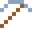

# Osmium

Das dichteste Element: Ein Würfel mit 10 cm Kante wiegt 22,6 kg.

| Eigenschaft | Wert |
|---|---|
| Symbol | Os |
| Ordnungszahl | 76 |
| Gruppe | Übergangsmetall |
| Zustand (20 °C) | fest |
| Dichte | 22,59 g/cm³ |
| Schmilzt bei | 3033 °C |
| Härte (Mohs) | 7 |
| Radioaktiv | nein, stabil |
| Ausrüstung daraus | ja |

## Herstellen

- 4 × [Platinmetall-Konzentrat](../gegenstaende/platinmetall_konzentrat.md) → 1 × [Osmium](../elemente/osmium.md) (Trennanlage, 30 s)

## Ausrüstung

Aus Osmium gibt es Werkzeuge, Waffen und Rüstung (Stufe 3):

-  Osmiumspitzhacke: 3 × Osmium + 2 × Bretter
-  Osmiumaxt: 3 × Osmium + 2 × Bretter
-  Osmiumschwert: 2 × Osmium + 1 × Bretter
-  Osmiumhelm: 5 × Osmium
-  Osmiumharnisch: 8 × Osmium
-  Osmiumbeinschutz: 7 × Osmium
-  Osmiumstiefel: 4 × Osmium

