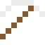
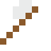

# Platin

Edel, selten, rostfrei – das Urkilogramm war aus Platin und Iridium.

| Eigenschaft | Wert |
|---|---|
| Symbol | Pt |
| Ordnungszahl | 78 |
| Gruppe | Übergangsmetall |
| Zustand (20 °C) | fest |
| Dichte | 21,45 g/cm³ |
| Schmilzt bei | 1768 °C |
| Härte (Mohs) | 3,5 |
| Radioaktiv | nein, stabil |
| Ausrüstung daraus | ja |

## Herstellen

- 1 × [Platinmetall-Konzentrat](../gegenstaende/platinmetall_konzentrat.md) → 1 × [Platin](../elemente/platin.md) (Trennanlage, 15 s)

## Ausrüstung

Aus Platin gibt es Werkzeuge, Waffen und Rüstung (Stufe 2):

-  Platinspitzhacke: 3 × Platin + 2 × Bretter
-  Platinaxt: 3 × Platin + 2 × Bretter
-  Platinschwert: 2 × Platin + 1 × Bretter
-  Platinhelm: 5 × Platin
-  Platinharnisch: 8 × Platin
-  Platinbeinschutz: 7 × Platin
-  Platinstiefel: 4 × Platin

## Verwendet für

[Platin-Iridium](../legierungen/platin_iridium.md)

