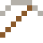

# Plutonium

Fühlt sich warm an. Die Voyager-Sonden fliegen seit fast 50 Jahren mit Plutonium-Batterien.

| Eigenschaft | Wert |
|---|---|
| Symbol | Pu |
| Ordnungszahl | 94 |
| Gruppe | Actinoid |
| Zustand (20 °C) | fest |
| Dichte | 19,816 g/cm³ |
| Schmilzt bei | 639 °C |
| Härte (Mohs) | 4 |
| Radioaktiv | ja, Halbwertszeit 80 Mio. Jahre |
| Ausrüstung daraus | ja |

## Herstellen

- 2 × [Uran](../elemente/uran.md) + 1 × [Uranbrennstab](../gegenstaende/uranbrennstab.md) → 1 × [Plutonium](../elemente/plutonium.md) (Forschungsreaktor, 60 s)

## Ausrüstung

Aus Plutonium gibt es Werkzeuge, Waffen und Rüstung (Stufe 2):

-  [Plutoniumspitzhacke](../elemente/plutonium.md): 3 × Plutonium + 2 × Bretter
-  [Plutoniumaxt](../elemente/plutonium.md): 3 × Plutonium + 2 × Bretter
-  [Plutoniumschwert](../elemente/plutonium.md): 2 × Plutonium + 1 × Bretter
-  [Plutoniumhelm](../gegenstaende/plutoniumhelm.md): 5 × Plutonium
-  [Plutoniumharnisch](../gegenstaende/plutoniumharnisch.md): 8 × Plutonium
-  [Plutoniumbeinschutz](../gegenstaende/plutoniumbeinschutz.md): 7 × Plutonium
-  [Plutoniumstiefel](../gegenstaende/plutoniumstiefel.md): 4 × Plutonium

## Verwendet für

[Americium](../elemente/americium.md), [Flerovium](../elemente/flerovium.md)

