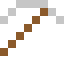

# Polonium

Von Marie Curie nach Polen benannt. Ein Gramm heizt sich selbst auf 500 °C.

| Eigenschaft | Wert |
|---|---|
| Symbol | Po |
| Ordnungszahl | 84 |
| Gruppe | Metall |
| Zustand (20 °C) | fest |
| Dichte | 9,196 g/cm³ |
| Schmilzt bei | 254 °C |
| Härte (Mohs) | 2 |
| Radioaktiv | ja, Halbwertszeit 125 Jahre |
| Ausrüstung daraus | ja |

## Herstellen

- 4 × [Bismut](../elemente/bismut.md) + 1 × [Uranbrennstab](../gegenstaende/uranbrennstab.md) → 1 × [Polonium](../elemente/polonium.md) (Forschungsreaktor, 90 s)

## Ausrüstung

Aus Polonium gibt es Werkzeuge, Waffen und Rüstung (Stufe 1):

-  Poloniumspitzhacke: 3 × Polonium + 2 × Bretter
-  Poloniumaxt: 3 × Polonium + 2 × Bretter
-  Poloniumschwert: 2 × Polonium + 1 × Bretter
-  Poloniumhelm: 5 × Polonium
-  Poloniumharnisch: 8 × Polonium
-  Poloniumbeinschutz: 7 × Polonium
-  Poloniumstiefel: 4 × Polonium

