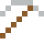
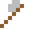
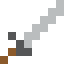

# Protactinium

Eines der seltensten und teuersten Elemente.

| Eigenschaft | Wert |
|---|---|
| Symbol | Pa |
| Ordnungszahl | 91 |
| Gruppe | Actinoid |
| Zustand (20 °C) | fest |
| Dichte | 15,37 g/cm³ |
| Schmilzt bei | 1568 °C |
| Härte (Mohs) | 4 |
| Radioaktiv | ja, Halbwertszeit 32 760 Jahre |
| Ausrüstung daraus | ja |

## Herstellen

- 4 × [Thorium](../elemente/thorium.md) + 1 × [Uranbrennstab](../gegenstaende/uranbrennstab.md) → 1 × [Protactinium](../elemente/protactinium.md) (Forschungsreaktor, 90 s)

## Ausrüstung

Aus Protactinium gibt es Werkzeuge, Waffen und Rüstung (Stufe 2):

-  Protactiniumspitzhacke: 3 × Protactinium + 2 × Bretter
-  Protactiniumaxt: 3 × Protactinium + 2 × Bretter
-  Protactiniumschwert: 2 × Protactinium + 1 × Bretter
-  Protactiniumhelm: 5 × Protactinium
-  Protactiniumharnisch: 8 × Protactinium
-  Protactiniumbeinschutz: 7 × Protactinium
-  Protactiniumstiefel: 4 × Protactinium

