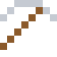
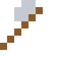

# Ruthenium

Eine drei Atome dünne Ruthenium-Schicht hielt die Daten in Festplatten fest.

| Eigenschaft | Wert |
|---|---|
| Symbol | Ru |
| Ordnungszahl | 44 |
| Gruppe | Übergangsmetall |
| Zustand (20 °C) | fest |
| Dichte | 12,45 g/cm³ |
| Schmilzt bei | 2334 °C |
| Härte (Mohs) | 6,5 |
| Radioaktiv | nein, stabil |
| Ausrüstung daraus | ja |

## Herstellen

- 2 × [Platinmetall-Konzentrat](../gegenstaende/platinmetall_konzentrat.md) → 1 × [Ruthenium](../elemente/ruthenium.md) (Trennanlage, 20 s)

## Ausrüstung

Aus Ruthenium gibt es Werkzeuge, Waffen und Rüstung (Stufe 3):

-  Rutheniumspitzhacke: 3 × Ruthenium + 2 × Bretter
-  Rutheniumaxt: 3 × Ruthenium + 2 × Bretter
-  Rutheniumschwert: 2 × Ruthenium + 1 × Bretter
-  Rutheniumhelm: 5 × Ruthenium
-  Rutheniumharnisch: 8 × Ruthenium
-  Rutheniumbeinschutz: 7 × Ruthenium
-  Rutheniumstiefel: 4 × Ruthenium

