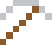
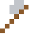
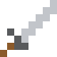

# Technetium

Das erste künstlich hergestellte Element (1937) – der Name heißt "künstlich". In Krankenhäusern wird es täglich zehntausendfach gespritzt.

| Eigenschaft | Wert |
|---|---|
| Symbol | Tc |
| Ordnungszahl | 43 |
| Gruppe | Übergangsmetall |
| Zustand (20 °C) | fest |
| Dichte | 11 g/cm³ |
| Schmilzt bei | 2157 °C |
| Härte (Mohs) | 5 |
| Radioaktiv | ja, Halbwertszeit 4,21 Mio. Jahre |
| Ausrüstung daraus | ja |

## Herstellen

- 4 × [Molybdän](../elemente/molybdaen.md) + 1 × [Uranbrennstab](../gegenstaende/uranbrennstab.md) → 1 × [Technetium](../elemente/technetium.md) (Forschungsreaktor, 60 s)

## Ausrüstung

Aus Technetium gibt es Werkzeuge, Waffen und Rüstung (Stufe 2):

-  [Technetiumspitzhacke](../elemente/technetium.md): 3 × Technetium + 2 × Bretter
-  [Technetiumaxt](../elemente/technetium.md): 3 × Technetium + 2 × Bretter
-  [Technetiumschwert](../elemente/technetium.md): 2 × Technetium + 1 × Bretter
-  [Technetiumhelm](../gegenstaende/technetiumhelm.md): 5 × Technetium
-  [Technetiumharnisch](../gegenstaende/technetiumharnisch.md): 8 × Technetium
-  [Technetiumbeinschutz](../gegenstaende/technetiumbeinschutz.md): 7 × Technetium
-  [Technetiumstiefel](../gegenstaende/technetiumstiefel.md): 4 × Technetium

