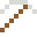

# Terbium

Grünes Leuchten in alten Bildschirmen und Energiesparlampen.

| Eigenschaft | Wert |
|---|---|
| Symbol | Tb |
| Ordnungszahl | 65 |
| Gruppe | Lanthanoid |
| Zustand (20 °C) | fest |
| Dichte | 8,23 g/cm³ |
| Schmilzt bei | 1356 °C |
| Härte (Mohs) | 3 |
| Radioaktiv | nein, stabil |
| Ausrüstung daraus | ja |

## Herstellen

- 6 × [Seltenerd-Konzentrat](../gegenstaende/seltenerd_konzentrat.md) → 1 × [Terbium](../elemente/terbium.md) (Trennanlage, 28 s)

## Ausrüstung

Aus Terbium gibt es Werkzeuge, Waffen und Rüstung (Stufe 1):

-  [Terbiumspitzhacke](../elemente/terbium.md): 3 × Terbium + 2 × Bretter
-  [Terbiumaxt](../elemente/terbium.md): 3 × Terbium + 2 × Bretter
-  [Terbiumschwert](../elemente/terbium.md): 2 × Terbium + 1 × Bretter
-  [Terbiumhelm](../gegenstaende/terbiumhelm.md): 5 × Terbium
-  [Terbiumharnisch](../gegenstaende/terbiumharnisch.md): 8 × Terbium
-  [Terbiumbeinschutz](../gegenstaende/terbiumbeinschutz.md): 7 × Terbium
-  [Terbiumstiefel](../gegenstaende/terbiumstiefel.md): 4 × Terbium

