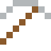

# Thallium

Geruchlos, geschmacklos – ein berüchtigtes Gift. Färbt Flammen grün.

| Eigenschaft | Wert |
|---|---|
| Symbol | Tl |
| Ordnungszahl | 81 |
| Gruppe | Metall |
| Zustand (20 °C) | fest |
| Dichte | 11,85 g/cm³ |
| Schmilzt bei | 304 °C |
| Härte (Mohs) | 1,2 |
| Radioaktiv | nein, stabil |
| Ausrüstung daraus | ja |

## Herstellen

- 4 × [Zinkrückstand](../gegenstaende/zinkrueckstand.md) → 1 × [Thallium](../elemente/thallium.md) (Trennanlage, 20 s)

## Ausrüstung

Aus Thallium gibt es Werkzeuge, Waffen und Rüstung (Stufe 0 – zu weich, taugt nichts):

-  Thalliumspitzhacke: 3 × Thallium + 2 × Bretter
-  Thalliumaxt: 3 × Thallium + 2 × Bretter
-  Thalliumschwert: 2 × Thallium + 1 × Bretter
-  Thalliumhelm: 5 × Thallium
-  Thalliumharnisch: 8 × Thallium
-  Thalliumbeinschutz: 7 × Thallium
-  Thalliumstiefel: 4 × Thallium

