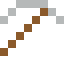
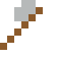
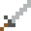

# Thorium

Dreimal so häufig wie Uran. Thorium-Reaktoren gelten als sicherere Atomkraft.

| Eigenschaft | Wert |
|---|---|
| Symbol | Th |
| Ordnungszahl | 90 |
| Gruppe | Actinoid |
| Zustand (20 °C) | fest |
| Dichte | 11,72 g/cm³ |
| Schmilzt bei | 1750 °C |
| Härte (Mohs) | 3 |
| Radioaktiv | ja, Halbwertszeit 14 050 Mio. Jahre |
| Ausrüstung daraus | ja |

## Herstellen

- 2 × [Seltenerd-Konzentrat](../gegenstaende/seltenerd_konzentrat.md) → 1 × [Thorium](../elemente/thorium.md) (Trennanlage, 15 s)

## Ausrüstung

Aus Thorium gibt es Werkzeuge, Waffen und Rüstung (Stufe 1):

-  Thoriumspitzhacke: 3 × Thorium + 2 × Bretter
-  Thoriumaxt: 3 × Thorium + 2 × Bretter
-  Thoriumschwert: 2 × Thorium + 1 × Bretter
-  Thoriumhelm: 5 × Thorium
-  Thoriumharnisch: 8 × Thorium
-  Thoriumbeinschutz: 7 × Thorium
-  Thoriumstiefel: 4 × Thorium

## Verwendet für

[Protactinium](../elemente/protactinium.md)

