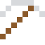

# Thulium

Die seltenste der stabilen Seltenen Erden.

| Eigenschaft | Wert |
|---|---|
| Symbol | Tm |
| Ordnungszahl | 69 |
| Gruppe | Lanthanoid |
| Zustand (20 °C) | fest |
| Dichte | 9,32 g/cm³ |
| Schmilzt bei | 1545 °C |
| Härte (Mohs) | 3 |
| Radioaktiv | nein, stabil |
| Ausrüstung daraus | ja |

## Herstellen

- 8 × [Seltenerd-Konzentrat](../gegenstaende/seltenerd_konzentrat.md) → 1 × [Thulium](../elemente/thulium.md) (Trennanlage, 34 s)

## Ausrüstung

Aus Thulium gibt es Werkzeuge, Waffen und Rüstung (Stufe 1):

-  Thuliumspitzhacke: 3 × Thulium + 2 × Bretter
-  Thuliumaxt: 3 × Thulium + 2 × Bretter
-  Thuliumschwert: 2 × Thulium + 1 × Bretter
-  Thuliumhelm: 5 × Thulium
-  Thuliumharnisch: 8 × Thulium
-  Thuliumbeinschutz: 7 × Thulium
-  Thuliumstiefel: 4 × Thulium

