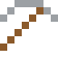
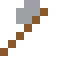
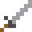

# Uran

Vor 2 Milliarden Jahren lief in Gabun ein natürlicher Kernreaktor – ganz von selbst, im Gestein.

| Eigenschaft | Wert |
|---|---|
| Symbol | U |
| Ordnungszahl | 92 |
| Gruppe | Actinoid |
| Zustand (20 °C) | fest |
| Dichte | 19,1 g/cm³ |
| Schmilzt bei | 1132 °C |
| Härte (Mohs) | 6 |
| Radioaktiv | ja, Halbwertszeit 4468 Mio. Jahre |
| Ausrüstung daraus | ja |

## Herstellen

- 4 × [Uranerz](../bloecke/uranerz.md) + 1 × [Schwefelsäure](../gegenstaende/schwefelsaeure.md) → 1 × [Uran](../elemente/uran.md) (Chemiereaktor, 15 s)

## Ausrüstung

Aus Uran gibt es Werkzeuge, Waffen und Rüstung (Stufe 3):

-  [Uranspitzhacke](../elemente/uran.md): 3 × Uran + 2 × Bretter
-  [Uranaxt](../elemente/uran.md): 3 × Uran + 2 × Bretter
-  [Uranschwert](../elemente/uran.md): 2 × Uran + 1 × Bretter
-  [Uranhelm](../gegenstaende/uranhelm.md): 5 × Uran
-  [Uranharnisch](../gegenstaende/uranharnisch.md): 8 × Uran
-  [Uranbeinschutz](../gegenstaende/uranbeinschutz.md): 7 × Uran
-  [Uranstiefel](../gegenstaende/uranstiefel.md): 4 × Uran

## Verwendet für

[Promethium](../elemente/promethium.md), [Neptunium](../elemente/neptunium.md), [Plutonium](../elemente/plutonium.md), [Uranhexafluorid](../gegenstaende/uranhexafluorid.md)

