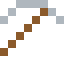
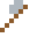

# Vanadium

Macht Stahl zäh – Henry Ford baute damit das Model T. Manteltiere im Meer reichern es in ihrem Blut an.

| Eigenschaft | Wert |
|---|---|
| Symbol | V |
| Ordnungszahl | 23 |
| Gruppe | Übergangsmetall |
| Zustand (20 °C) | fest |
| Dichte | 6 g/cm³ |
| Schmilzt bei | 1910 °C |
| Härte (Mohs) | 6,7 |
| Radioaktiv | nein, stabil |
| Ausrüstung daraus | ja |

## Herstellen

- 4 × [Ilmenit](../bloecke/ilmenit.md) + 1 × [Natronlauge](../gegenstaende/natronlauge.md) → 1 × [Vanadium](../elemente/vanadium.md) (Chemiereaktor, 15 s)

## Ausrüstung

Aus Vanadium gibt es Werkzeuge, Waffen und Rüstung (Stufe 3):

-  [Vanadiumspitzhacke](../elemente/vanadium.md): 3 × Vanadium + 2 × Bretter
-  [Vanadiumaxt](../elemente/vanadium.md): 3 × Vanadium + 2 × Bretter
-  [Vanadiumschwert](../elemente/vanadium.md): 2 × Vanadium + 1 × Bretter
-  [Vanadiumhelm](../gegenstaende/vanadiumhelm.md): 5 × Vanadium
-  [Vanadiumharnisch](../gegenstaende/vanadiumharnisch.md): 8 × Vanadium
-  [Vanadiumbeinschutz](../gegenstaende/vanadiumbeinschutz.md): 7 × Vanadium
-  [Vanadiumstiefel](../gegenstaende/vanadiumstiefel.md): 4 × Vanadium

## Verwendet für

[Aluminium-Vanadium](../legierungen/aluminium_vanadium.md), [Damaszener Stahl](../legierungen/damaszener_stahl.md)

