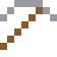
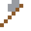

# Wolfram

Der höchste Schmelzpunkt aller Metalle: 3422 °C. Die Glühfäden alter Glühbirnen.

| Eigenschaft | Wert |
|---|---|
| Symbol | W |
| Ordnungszahl | 74 |
| Gruppe | Übergangsmetall |
| Zustand (20 °C) | fest |
| Dichte | 19,25 g/cm³ |
| Schmilzt bei | 3422 °C |
| Härte (Mohs) | 7,5 |
| Radioaktiv | nein, stabil |
| Ausrüstung daraus | ja |

## Herstellen

- 2 × [Wolframit](../bloecke/wolframit.md) + 1 × [Wasserstoff](../elemente/wasserstoff.md) → 1 × [Wolfram](../elemente/wolfram.md) (Chemiereaktor, 15 s)

## Ausrüstung

Aus Wolfram gibt es Werkzeuge, Waffen und Rüstung (Stufe 4):

-  Wolframspitzhacke: 3 × Wolfram + 2 × Bretter
-  Wolframaxt: 3 × Wolfram + 2 × Bretter
-  Wolframschwert: 2 × Wolfram + 1 × Bretter
-  Wolframhelm: 5 × Wolfram
-  Wolframharnisch: 8 × Wolfram
-  Wolframbeinschutz: 7 × Wolfram
-  Wolframstiefel: 4 × Wolfram

## Verwendet für

[Hartmetall](../legierungen/hartmetall.md), [Schwermetall](../legierungen/schwermetall.md), [Schnellarbeitsstahl](../legierungen/schnellarbeitsstahl.md)

