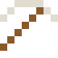
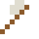
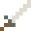

# Ytterbium

Ytterbium-Atomuhren gehen in Milliarden Jahren kaum eine Sekunde falsch.

| Eigenschaft | Wert |
|---|---|
| Symbol | Yb |
| Ordnungszahl | 70 |
| Gruppe | Lanthanoid |
| Zustand (20 °C) | fest |
| Dichte | 6,9 g/cm³ |
| Schmilzt bei | 824 °C |
| Härte (Mohs) | 2 |
| Radioaktiv | nein, stabil |
| Ausrüstung daraus | ja |

## Herstellen

- 4 × [Seltenerd-Konzentrat](../gegenstaende/seltenerd_konzentrat.md) → 1 × [Ytterbium](../elemente/ytterbium.md) (Trennanlage, 22 s)

## Ausrüstung

Aus Ytterbium gibt es Werkzeuge, Waffen und Rüstung (Stufe 1):

-  Ytterbiumspitzhacke: 3 × Ytterbium + 2 × Bretter
-  Ytterbiumaxt: 3 × Ytterbium + 2 × Bretter
-  Ytterbiumschwert: 2 × Ytterbium + 1 × Bretter
-  Ytterbiumhelm: 5 × Ytterbium
-  Ytterbiumharnisch: 8 × Ytterbium
-  Ytterbiumbeinschutz: 7 × Ytterbium
-  Ytterbiumstiefel: 4 × Ytterbium

