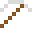
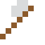
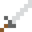

# Yttrium

Eines von vier Elementen, benannt nach dem schwedischen Dorf Ytterby – wie Ytterbium, Terbium und Erbium.

| Eigenschaft | Wert |
|---|---|
| Symbol | Y |
| Ordnungszahl | 39 |
| Gruppe | Übergangsmetall |
| Zustand (20 °C) | fest |
| Dichte | 4,472 g/cm³ |
| Schmilzt bei | 1526 °C |
| Härte (Mohs) | 2,5 |
| Radioaktiv | nein, stabil |
| Ausrüstung daraus | ja |

## Herstellen

- 2 × [Seltenerd-Konzentrat](../gegenstaende/seltenerd_konzentrat.md) → 1 × [Yttrium](../elemente/yttrium.md) (Trennanlage, 15 s)

## Ausrüstung

Aus Yttrium gibt es Werkzeuge, Waffen und Rüstung (Stufe 1):

-  Yttriumspitzhacke: 3 × Yttrium + 2 × Bretter
-  Yttriumaxt: 3 × Yttrium + 2 × Bretter
-  Yttriumschwert: 2 × Yttrium + 1 × Bretter
-  Yttriumhelm: 5 × Yttrium
-  Yttriumharnisch: 8 × Yttrium
-  Yttriumbeinschutz: 7 × Yttrium
-  Yttriumstiefel: 4 × Yttrium

## Verwendet für

[YBCO-Supraleiter](../gegenstaende/ybco_supraleiter.md)

