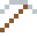

# Zink

Rostet lieber selbst, als das Eisen darunter rosten zu lassen – deshalb verzinkt man Stahl.

| Eigenschaft | Wert |
|---|---|
| Symbol | Zn |
| Ordnungszahl | 30 |
| Gruppe | Übergangsmetall |
| Zustand (20 °C) | fest |
| Dichte | 7,14 g/cm³ |
| Schmilzt bei | 420 °C |
| Härte (Mohs) | 2,5 |
| Radioaktiv | nein, stabil |
| Ausrüstung daraus | ja |

## Herstellen

- 1 × [Zinkblende](../bloecke/zinkblende.md) → 1 × [Zink](../elemente/zink.md) (Ofen, 5 s)

## Ausrüstung

Aus Zink gibt es Werkzeuge, Waffen und Rüstung (Stufe 1):

-  [Zinkspitzhacke](../elemente/zink.md): 3 × Zink + 2 × Bretter
-  [Zinkaxt](../elemente/zink.md): 3 × Zink + 2 × Bretter
-  [Zinkschwert](../elemente/zink.md): 2 × Zink + 1 × Bretter
-  [Zinkhelm](../gegenstaende/zinkhelm.md): 5 × Zink
-  [Zinkharnisch](../gegenstaende/zinkharnisch.md): 8 × Zink
-  [Zinkbeinschutz](../gegenstaende/zinkbeinschutz.md): 7 × Zink
-  [Zinkstiefel](../gegenstaende/zinkstiefel.md): 4 × Zink

## Verwendet für

[Silber](../elemente/silber.md), [Copernicium](../elemente/copernicium.md), [Nihonium](../elemente/nihonium.md), [Messing](../legierungen/messing.md), [Zamak](../legierungen/zamak.md), [Zinkkabel](../gegenstaende/zinkkabel.md)

