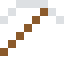

# Zinn

Unter 13 °C zerfällt es langsam zu grauem Pulver ("Zinnpest") – angeblich zerbröselten so Napoleons Uniformknöpfe in Russland.

| Eigenschaft | Wert |
|---|---|
| Symbol | Sn |
| Ordnungszahl | 50 |
| Gruppe | Metall |
| Zustand (20 °C) | fest |
| Dichte | 7,287 g/cm³ |
| Schmilzt bei | 232 °C |
| Härte (Mohs) | 1,5 |
| Radioaktiv | nein, stabil |
| Ausrüstung daraus | ja |

## Herstellen

- 1 × [Zinnstein](../bloecke/zinnstein.md) → 1 × [Zinn](../elemente/zinn.md) (Ofen, 5 s)

## Ausrüstung

Aus Zinn gibt es Werkzeuge, Waffen und Rüstung (Stufe 1):

-  [Zinnspitzhacke](../elemente/zinn.md): 3 × Zinn + 2 × Bretter
-  [Zinnaxt](../elemente/zinn.md): 3 × Zinn + 2 × Bretter
-  [Zinnschwert](../elemente/zinn.md): 2 × Zinn + 1 × Bretter
-  [Zinnhelm](../gegenstaende/zinnhelm.md): 5 × Zinn
-  [Zinnharnisch](../gegenstaende/zinnharnisch.md): 8 × Zinn
-  [Zinnbeinschutz](../gegenstaende/zinnbeinschutz.md): 7 × Zinn
-  [Zinnstiefel](../gegenstaende/zinnstiefel.md): 4 × Zinn

## Verwendet für

[Bronze](../legierungen/bronze.md), [Lötzinn](../legierungen/loetzinn.md), [Zirkaloy](../legierungen/zirkaloy.md), [Glockenbronze](../legierungen/glockenbronze.md), [Hartzinn](../legierungen/hartzinn.md)

