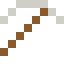
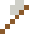
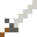

# Zirconium

Neutronen fliegen fast ungehindert hindurch – deshalb sind Brennstabhüllen aus Zirconium. Zirkonia sieht aus wie Diamant.

| Eigenschaft | Wert |
|---|---|
| Symbol | Zr |
| Ordnungszahl | 40 |
| Gruppe | Übergangsmetall |
| Zustand (20 °C) | fest |
| Dichte | 6,52 g/cm³ |
| Schmilzt bei | 1855 °C |
| Härte (Mohs) | 5 |
| Radioaktiv | nein, stabil |
| Ausrüstung daraus | ja |

## Herstellen

- 2 × [Zirkon](../bloecke/zirkon.md) + 1 × [Magnesium](../elemente/magnesium.md) → 1 × [Zirconium](../elemente/zirconium.md) (Chemiereaktor, 15 s)

## Ausrüstung

Aus Zirconium gibt es Werkzeuge, Waffen und Rüstung (Stufe 2):

-  [Zirconiumspitzhacke](../elemente/zirconium.md): 3 × Zirconium + 2 × Bretter
-  [Zirconiumaxt](../elemente/zirconium.md): 3 × Zirconium + 2 × Bretter
-  [Zirconiumschwert](../elemente/zirconium.md): 2 × Zirconium + 1 × Bretter
-  [Zirconiumhelm](../gegenstaende/zirconiumhelm.md): 5 × Zirconium
-  [Zirconiumharnisch](../gegenstaende/zirconiumharnisch.md): 8 × Zirconium
-  [Zirconiumbeinschutz](../gegenstaende/zirconiumbeinschutz.md): 7 × Zirconium
-  [Zirconiumstiefel](../gegenstaende/zirconiumstiefel.md): 4 × Zirconium

## Verwendet für

[Hafnium](../elemente/hafnium.md), [Zirkaloy](../legierungen/zirkaloy.md)

