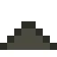

# Anodenschlamm

Fällt beim Reinigen von Kupfer ab – voller Silber, Gold, Selen und Tellur.

## Herstellen

- 8 × [Kupferbarren](../elemente/kupferbarren.md) → 1 × [Anodenschlamm](../gegenstaende/anodenschlamm.md) (Elektrolyseanlage, 20 s)

## Verwendet für

[Selen](../elemente/selen.md), [Tellur](../elemente/tellur.md), [Silber](../elemente/silber.md)

