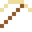
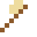

# Kubisches Bornitrid

Nach Diamant das härteste Material – und anders als Diamant hält es Stahl und Hitze aus. Das härteste Werkzeug, das es gibt.

| Eigenschaft | Wert |
|---|---|
| Keramik · Dichte | 3,45 g/cm³ |
| Härte | 9,8 (Mohs) |

## Herstellen

- 1 × [Bor](../elemente/bor.md) + 1 × [Stickstoff](../elemente/stickstoff.md) → 1 × [Kubisches Bornitrid](../gegenstaende/kubisches_bornitrid.md) (Induktionsofen, 15 s)

## Ausrüstung

Aus Kubisches Bornitrid gibt es Werkzeuge, Waffen und Rüstung (Stufe 4):

-  [Bornitridspitzhacke](../gegenstaende/kubisches_bornitrid.md): 3 × Kubisches Bornitrid + 2 × Bretter
-  [Bornitridaxt](../gegenstaende/kubisches_bornitrid.md): 3 × Kubisches Bornitrid + 2 × Bretter
-  [Bornitridschwert](../gegenstaende/kubisches_bornitrid.md): 2 × Kubisches Bornitrid + 1 × Bretter
-  [Bornitridhelm](../gegenstaende/bornitridhelm.md): 5 × Kubisches Bornitrid
-  [Bornitridharnisch](../gegenstaende/bornitridharnisch.md): 8 × Kubisches Bornitrid
-  [Bornitridbeinschutz](../gegenstaende/bornitridbeinschutz.md): 7 × Kubisches Bornitrid
-  [Bornitridstiefel](../gegenstaende/bornitridstiefel.md): 4 × Kubisches Bornitrid

