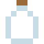

# Leere Trinkflasche

Rechtsklick ins Wasser füllt sie. Wo es kein Wasser gibt (Mond, Mars, Weltall), nimmt man besser ein paar volle mit.

| Eigenschaft | Wert |
|---|---|
| Rechtsklick ins Wasser | füllen |

## Herstellen

- 3 × [Glas](../bloecke/glas.md) + 1 × [Stock](../gegenstaende/stock.md) → 2 × [Leere Trinkflasche](../gegenstaende/leere_trinkflasche.md) (Werkbank, 1 s)

