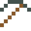
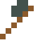

# Siliziumcarbid

Als Moissanit zuerst in einem Meteoritenkrater entdeckt. Härter als jedes Metall: Werkzeuge daraus übertreffen Wolfram.

| Eigenschaft | Wert |
|---|---|
| Keramik · Dichte | 3,21 g/cm³ |
| Härte | 9,5 (Mohs) |

## Herstellen

- 1 × [Silizium](../elemente/silizium.md) + 1 × [Kohle](../gegenstaende/kohle.md) → 1 × [Siliziumcarbid](../gegenstaende/siliziumcarbid.md) (Induktionsofen, 10 s)

## Ausrüstung

Aus Siliziumcarbid gibt es Werkzeuge, Waffen und Rüstung (Stufe 4):

-  [Siliziumcarbidspitzhacke](../gegenstaende/siliziumcarbid.md): 3 × Siliziumcarbid + 2 × Bretter
-  [Siliziumcarbidaxt](../gegenstaende/siliziumcarbid.md): 3 × Siliziumcarbid + 2 × Bretter
-  [Siliziumcarbidschwert](../gegenstaende/siliziumcarbid.md): 2 × Siliziumcarbid + 1 × Bretter
-  [Siliziumcarbidhelm](../gegenstaende/siliziumcarbidhelm.md): 5 × Siliziumcarbid
-  [Siliziumcarbidharnisch](../gegenstaende/siliziumcarbidharnisch.md): 8 × Siliziumcarbid
-  [Siliziumcarbidbeinschutz](../gegenstaende/siliziumcarbidbeinschutz.md): 7 × Siliziumcarbid
-  [Siliziumcarbidstiefel](../gegenstaende/siliziumcarbidstiefel.md): 4 × Siliziumcarbid

