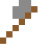

# Steinaxt

## Herstellen

- 3 × [Bruchstein](../bloecke/bruchstein.md) oder [Bruchgneis](../bloecke/bruchgneis.md) oder [Stein](../bloecke/stein.md) + 2 × [Bretter](../bloecke/bretter.md) oder [Fichtenholzbretter](../bloecke/fichtenholzbretter.md) oder [Birkenholzbretter](../bloecke/birkenholzbretter.md) (oder eins von 6 weiteren) → 1 × [Steinaxt](../gegenstaende/steinaxt.md) (Werkbank, 3 s)

