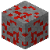

# Erde

Der einzige Ort, von dem wir wissen, dass es Leben gibt. Sie ist der dichteste Planet des Sonnensystems.

| Eigenschaft | Wert |
|---|---|
| Art | Planet |
| Radius | 6371 km |
| Masse | 5,97 · 10^24 kg |
| Schwerkraft | 1 g (9,81 m/s²) |
| Kabelumgebung | 20 °C |
| Kabelkühlung (Spielwert) | 100 % |
| Sprunghöhe | 1,25 m |
| Höchster Berg | 8,85 km |
| Berge im Schnitt | 2,5 km |
| Meerestiefe im Schnitt | 3,7 km |
| Tiefster Punkt | −10,9 km |
| Bauhöhe | 20 km |
| Grabtiefe | 12,9 km |
| Ein Tag | 24 h |
| Umlauf um die Sonne (ein Jahr) | 365 Tage |
| Abstand zur Sonne | 1 AE (150 Mio. km) |
| Exzentrizität | 0,017 |
| Atmosphäre | bis 100 km hoch, atembar bis 8 km, Wolken |
| Strahlung am Boden | 0 µSv/h |
| Oberfläche | Gras, Erde, Sand, Schnee, Wüsten und Polkappen – wie die Erde |
| Meere | [Wasser](../bloecke/wasser.md) |

## Rohstoffe

Erzadern im Gestein (je mehr Adern, desto häufiger):

| Erz | Adern je Chunk | Tiefe |
|---|---|---|
|  [Kohleerz](../bloecke/kohleerz.md) | 0,9 | −40 bis 160 |
|  [Eisenerz](../bloecke/eisenerz.md) | 0,75 | −128 bis 120 |
|  [Kupfererz](../bloecke/kupfererz.md) | 0,55 | −110 bis 80 |
|  [Kalkstein](../bloecke/kalkstein.md) | 0,3 | −30 bis 160 |
|  [Bauxit](../bloecke/bauxit.md) | 0,25 | −20 bis 80 |
|  [Quarzerz](../bloecke/quarzerz.md) | 0,3 | −128 bis 0 |
|  [Schwefelerz](../bloecke/schwefelerz.md) | 0,2 | −128 bis −30 |
|  [Golderz](../bloecke/golderz.md) | 0,15 | −128 bis −40 |
|  [Uranerz](../bloecke/uranerz.md) | 0,08 | −128 bis −80 |
|  [Diamanterz](../bloecke/diamanterz.md) | 0,06 | −128 bis −100 |
|  [Ölschiefer](../bloecke/oelschiefer.md) | 0,25 | −90 bis 20 |
|  [Bleiglanz](../bloecke/bleiglanz.md) | 0,25 | −110 bis 60 |
|  [Zinkblende](../bloecke/zinkblende.md) | 0,25 | −110 bis 60 |
|  [Zinnstein](../bloecke/zinnstein.md) | 0,12 | −100 bis 40 |
|  [Chromit](../bloecke/chromit.md) | 0,12 | −128 bis 0 |
|  [Braunstein](../bloecke/braunstein.md) | 0,15 | −60 bis 80 |
|  [Pentlandit](../bloecke/pentlandit.md) | 0,1 | −128 bis −40 |
|  [Molybdänglanz](../bloecke/molybdaenglanz.md) | 0,08 | −128 bis −20 |
|  [Wolframit](../bloecke/wolframit.md) | 0,07 | −128 bis −30 |
|  [Zinnober](../bloecke/zinnober.md) | 0,06 | −60 bis 60 |
|  [Monazit](../bloecke/monazit.md) | 0,08 | −90 bis 40 |
|  [Spodumen](../bloecke/spodumen.md) | 0,08 | −80 bis 40 |
|  [Beryll](../bloecke/beryll.md) | 0,05 | −100 bis 20 |
|  [Sylvin](../bloecke/sylvin.md) | 0,12 | −60 bis 20 |
|  [Flussspat](../bloecke/flussspat.md) | 0,12 | −90 bis 60 |
|  [Dolomit](../bloecke/dolomit.md) | 0,2 | −40 bis 120 |
|  [Antimonit](../bloecke/antimonit.md) | 0,06 | −90 bis 20 |
|  [Arsenkies](../bloecke/arsenkies.md) | 0,06 | −90 bis 20 |
|  [Zirkon](../bloecke/zirkon.md) | 0,07 | −60 bis 60 |
|  [Coltan](../bloecke/coltan.md) | 0,04 | −128 bis −20 |
|  [Bismuthinit](../bloecke/bismuthinit.md) | 0,05 | −100 bis 0 |
|  [Borax](../bloecke/borax.md) | 0,06 | −20 bis 60 |
|  [Apatit](../bloecke/apatit.md) | 0,1 | −80 bis 60 |
|  [Coelestin](../bloecke/coelestin.md) | 0,06 | −60 bis 40 |
|  [Baryt](../bloecke/baryt.md) | 0,08 | −80 bis 40 |
|  [Lepidolith](../bloecke/lepidolith.md) | 0,05 | −100 bis 20 |
|  [Salz](../bloecke/salz.md) | 0,12 | −80 bis 30 |
|  [Granit](../bloecke/granit.md) | 0,35 | −100 bis 140 |
|  [Diorit](../bloecke/diorit.md) | 0,35 | −100 bis 140 |
|  [Andesit](../bloecke/andesit.md) | 0,35 | −100 bis 140 |
|  [Tuffstein](../bloecke/tuffstein.md) | 0,3 | −128 bis −40 |
|  [Lapislazulierz](../bloecke/lapislazulierz.md) | 0,1 | −110 bis 20 |
|  [Smaragderz](../bloecke/smaragderz.md) | 0,06 | 40 bis 160 |
|  [Signalerz](../bloecke/signalerz.md) | 0,16 | −128 bis −16 |

Tiefe in Blöcken über dem Meeresspiegel (0); das Grundgestein liegt bei −128.

## Monde (1)

| Name | Radius | Abstand | Umlauf | Richtung | Schwerkraft |
|---|---|---|---|---|---|
| [Mond](../himmelskoerper/mond.md) | 1737 km | 384 400 km | 27,3 Tage | vorwärts | 0,166 g |

