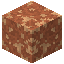
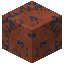

# Mars

Hier steht der Olympus Mons, der höchste Vulkan des Sonnensystems – zweieinhalbmal so hoch wie der Mount Everest. Rot ist er, weil er rostet.

| Eigenschaft | Wert |
|---|---|
| Art | Planet |
| Radius | 3390 km |
| Masse | 6,42 · 10^23 kg |
| Schwerkraft | 0,379 g (3,72 m/s²) |
| Sprunghöhe | 3,3 m |
| Ein Tag | 24,7 h |
| Umlauf um die Sonne (ein Jahr) | 687 Tage |
| Abstand zur Sonne | 1,524 AE (228 Mio. km) |
| Exzentrizität | 0,093 |
| Atmosphäre | bis 60 km hoch, nicht atembar (Raumanzug) |
| Strahlung am Boden | 379 mSv/h |
| Oberfläche | [Roter Sand](../bloecke/roter_sand.md), [Roter Fels](../bloecke/roter_fels.md), [Eis](../bloecke/eis.md) |

## Rohstoffe

Erzadern im Gestein (je mehr Adern, desto häufiger):

| Erz | Adern je Chunk | Tiefe |
|---|---|---|
|  [Eisenerz](../bloecke/eisenerz.md) | 1,1 | −128 bis 150 |
|  [Schwefelerz](../bloecke/schwefelerz.md) | 0,35 | −128 bis 60 |
|  [Quarzerz](../bloecke/quarzerz.md) | 0,3 | −128 bis 40 |
|  [Kupfererz](../bloecke/kupfererz.md) | 0,25 | −128 bis 40 |
|  [Bauxit](../bloecke/bauxit.md) | 0,15 | −40 bis 80 |
|  [Golderz](../bloecke/golderz.md) | 0,08 | −128 bis −40 |
|  [Uranerz](../bloecke/uranerz.md) | 0,05 | −128 bis −60 |
|  [Hämatit](../bloecke/haematit.md) | 0,4 | −128 bis 120 |

Tiefe in Blöcken über dem Meeresspiegel (0); das Grundgestein liegt bei −128.

## Monde (2)

| Name | Radius | Abstand | Umlauf | Richtung | Schwerkraft |
|---|---|---|---|---|---|
| [Phobos](../himmelskoerper/phobos.md) | 11,1 km | 9375 km | 7,65 h | vorwärts | 0,000588 g |
| [Deimos](../himmelskoerper/deimos.md) | 6,2 km | 23 457 km | 30,3 h | vorwärts | 0,000255 g |

