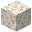
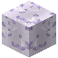

# Rhea

Saturns zweitgrößter Mond – womöglich mit einem eigenen, hauchdünnen Ring.

| Eigenschaft | Wert |
|---|---|
| Art | Mond von [Saturn](../himmelskoerper/saturn.md) |
| Radius | 764 km |
| Masse | 2,31 · 10^21 kg |
| Schwerkraft | 0,0269 g (0,26 m/s²) |
| Sprunghöhe | 46,5 m |
| Ein Tag | 4,52 Tage |
| Umlauf | 4,52 Tage |
| Abstand zu Saturn | 527 200 km |
| Exzentrizität | 0,001 |
| Richtung | vorwärts |
| Gebundene Rotation | zeigt seinem Planeten immer dieselbe Seite |
| Atmosphäre | keine (Raumanzug) |
| Strahlung am Boden | 524 mSv/h |
| Oberfläche | [Graues Eis](../bloecke/graues_eis.md), [Schmutziges Eis](../bloecke/schmutziges_eis.md) |

## Rohstoffe

Erzadern im Gestein (je mehr Adern, desto häufiger):

| Erz | Adern je Chunk | Tiefe |
|---|---|---|
|  [Quarzerz](../bloecke/quarzerz.md) | 0,12 | −128 bis 60 |
|  [Eisenerz](../bloecke/eisenerz.md) | 0,12 | −128 bis 60 |
|  [Salz](../bloecke/salz.md) | 0,35 | −128 bis 140 |
|  [Methaneis](../bloecke/methaneis.md) | 0,3 | −60 bis 160 |

Tiefe in Blöcken über dem Meeresspiegel (0); das Grundgestein liegt bei −128.

