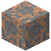
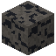
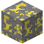
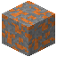
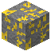
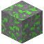

# S/2023 S 29

| | |
|---|---|
| Art | Mond von [Saturn](../himmelskoerper/saturn.md) |
| Radius | 1,5 km |
| Masse | 1,4 · 10^13 kg |
| Schwerkraft | 0 g (0 m/s²) |
| Sprunghöhe | 1,5 km |
| Ein Tag | 10 h |
| Umlauf | 2,9 Jahre |
| Abstand zu Saturn | 0,134 AE (20 Mio. km) |
| Exzentrizität | 0,141 |
| Richtung | rückwärts |
| Atmosphäre | keine (Raumanzug) |
| Strahlung am Boden | 506 mSv/h |
| Oberfläche | [Dunkler Regolith](../bloecke/dunkler_regolith.md), [Basalt](../bloecke/basalt.md) |

## Rohstoffe

Erzadern im Gestein (je mehr Adern, desto häufiger):

| Erz | Adern je Chunk | Tiefe |
|---|---|---|
|  [Eisenerz](../bloecke/eisenerz.md) | 0,55 | −128 bis 120 |
|  [Ilmenit](../bloecke/ilmenit.md) | 0,35 | −128 bis 80 |
|  [Schwefelerz](../bloecke/schwefelerz.md) | 0,3 | −128 bis 80 |
|  [Quarzerz](../bloecke/quarzerz.md) | 0,25 | −128 bis 40 |
|  [Kupfererz](../bloecke/kupfererz.md) | 0,2 | −128 bis 40 |
|  [Golderz](../bloecke/golderz.md) | 0,08 | −128 bis −40 |
|  [Uranerz](../bloecke/uranerz.md) | 0,05 | −128 bis −60 |

Tiefe in Blöcken über dem Meeresspiegel (0); das Grundgestein liegt bei −128.

