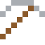

# Alnico

Die ersten starken Dauermagnete der 1930er – E-Gitarren klingen auch deshalb so.

| Eigenschaft | Wert |
|---|---|
|  | Aus Aluminium, Nickel, Cobalt (Dauermagnet) |
| Dichte | 7,3 g/cm³ |
| Schmilzt bei | 1327 °C |
| Härte | 5 (Mohs) |

## Herstellen

- 1 × [Aluminiumbarren](../elemente/aluminiumbarren.md) + 2 × [Nickel](../elemente/nickel.md) → 3 × [Alnico](../legierungen/alnico.md) (Induktionsofen, 8 s)

## Ausrüstung

Aus Alnico gibt es Werkzeuge, Waffen und Rüstung (Stufe 2):

-  [Alnicospitzhacke](../legierungen/alnico.md): 3 × Alnico + 2 × Bretter
-  [Alnicoaxt](../legierungen/alnico.md): 3 × Alnico + 2 × Bretter
-  [Alnicoschwert](../legierungen/alnico.md): 2 × Alnico + 1 × Bretter
-  [Alnicohelm](../gegenstaende/alnicohelm.md): 5 × Alnico
-  [Alnicoharnisch](../gegenstaende/alnicoharnisch.md): 8 × Alnico
-  [Alnicobeinschutz](../gegenstaende/alnicobeinschutz.md): 7 × Alnico
-  [Alnicostiefel](../gegenstaende/alnicostiefel.md): 4 × Alnico

