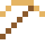

# Aluminiumbronze

Goldfarben, aber rostfrei: die 10-, 20- und 50-Cent-Münzen ("Nordisches Gold").

| Eigenschaft | Wert |
|---|---|
|  | Aus Kupfer mit Aluminium |
| Dichte | 7,6 g/cm³ |
| Schmilzt bei | 1047 °C |
| Härte | 3,5 (Mohs) |

## Herstellen

- 9 × [Kupferbarren](../elemente/kupferbarren.md) + 1 × [Aluminiumbarren](../elemente/aluminiumbarren.md) → 10 × [Aluminiumbronze](../legierungen/aluminiumbronze.md) (Induktionsofen, 8 s)

## Ausrüstung

Aus Aluminiumbronze gibt es Werkzeuge, Waffen und Rüstung (Stufe 2):

-  Aluminiumbronzespitzhacke: 3 × Aluminiumbronze + 2 × Bretter
-  Aluminiumbronzeaxt: 3 × Aluminiumbronze + 2 × Bretter
-  Aluminiumbronzeschwert: 2 × Aluminiumbronze + 1 × Bretter
-  Aluminiumbronzehelm: 5 × Aluminiumbronze
-  Aluminiumbronzeharnisch: 8 × Aluminiumbronze
-  Aluminiumbronzebeinschutz: 7 × Aluminiumbronze
-  Aluminiumbronzestiefel: 4 × Aluminiumbronze

