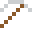
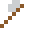
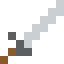

# Amalgam

Jahrhundertelang die Füllung in Zähnen.

| Eigenschaft | Wert |
|---|---|
|  | Aus Quecksilber und Silber |
| Dichte | 11,5 g/cm³ |
| Schmilzt bei | 327 °C |
| Härte | 2 (Mohs) |

## Herstellen

- 1 × [Quecksilber](../elemente/quecksilber.md) + 1 × [Silber](../elemente/silber.md) → 2 × [Amalgam](../legierungen/amalgam.md) (Induktionsofen, 8 s)

## Ausrüstung

Aus Amalgam gibt es Werkzeuge, Waffen und Rüstung (Stufe 1):

-  Amalgamspitzhacke: 3 × Amalgam + 2 × Bretter
-  Amalgamaxt: 3 × Amalgam + 2 × Bretter
-  Amalgamschwert: 2 × Amalgam + 1 × Bretter
-  Amalgamhelm: 5 × Amalgam
-  Amalgamharnisch: 8 × Amalgam
-  Amalgambeinschutz: 7 × Amalgam
-  Amalgamstiefel: 4 × Amalgam

