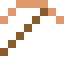

# Berylliumkupfer

Schlägt keine Funken – Werkzeug für Ölplattformen und Munitionslager.

| Eigenschaft | Wert |
|---|---|
|  | Aus Kupfer mit Beryllium (funkt nicht) |
| Dichte | 8,25 g/cm³ |
| Schmilzt bei | 877 °C |
| Härte | 4 (Mohs) |

## Herstellen

- 9 × [Kupferbarren](../elemente/kupferbarren.md) + 1 × [Beryllium](../elemente/beryllium.md) → 10 × [Berylliumkupfer](../legierungen/berylliumkupfer.md) (Induktionsofen, 8 s)

## Ausrüstung

Aus Berylliumkupfer gibt es Werkzeuge, Waffen und Rüstung (Stufe 2):

-  Berylliumkupferspitzhacke: 3 × Berylliumkupfer + 2 × Bretter
-  Berylliumkupferaxt: 3 × Berylliumkupfer + 2 × Bretter
-  Berylliumkupferschwert: 2 × Berylliumkupfer + 1 × Bretter
-  Berylliumkupferhelm: 5 × Berylliumkupfer
-  Berylliumkupferharnisch: 8 × Berylliumkupfer
-  Berylliumkupferbeinschutz: 7 × Berylliumkupfer
-  Berylliumkupferstiefel: 4 × Berylliumkupfer

