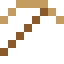

# Bronze

Gab einem ganzen Zeitalter den Namen: der Bronzezeit, vor 5000 Jahren.

| Eigenschaft | Wert |
|---|---|
|  | Aus Kupfer und Zinn |
| Dichte | 8,8 g/cm³ |
| Schmilzt bei | 950 °C |
| Härte | 3 (Mohs) |

## Herstellen

- 3 × [Kupferbarren](../elemente/kupferbarren.md) + 1 × [Zinn](../elemente/zinn.md) → 4 × [Bronze](../legierungen/bronze.md) (Induktionsofen, 8 s)

## Ausrüstung

Aus Bronze gibt es Werkzeuge, Waffen und Rüstung (Stufe 1):

-  Bronzespitzhacke: 3 × Bronze + 2 × Bretter
-  Bronzeaxt: 3 × Bronze + 2 × Bretter
-  Bronzeschwert: 2 × Bronze + 1 × Bretter
-  Bronzehelm: 5 × Bronze
-  Bronzeharnisch: 8 × Bronze
-  Bronzebeinschutz: 7 × Bronze
-  Bronzestiefel: 4 × Bronze

