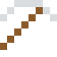

# Edelstahl

Ab 10,5 % Chrom bildet sich eine unsichtbare Haut, die sich bei jedem Kratzer von selbst erneuert – deshalb rostet er nicht.

| Eigenschaft | Wert |
|---|---|
|  | Aus Stahl mit Chrom und Nickel (rostet nicht) |
| Dichte | 8 g/cm³ |
| Schmilzt bei | 1427 °C |
| Härte | 5,5 (Mohs) |

## Herstellen

- 3 × [Stahl](../legierungen/stahl.md) + 1 × [Nichrom](../legierungen/nichrom.md) → 4 × [Edelstahl](../legierungen/edelstahl.md) (Induktionsofen, 8 s)

## Ausrüstung

Aus Edelstahl gibt es Werkzeuge, Waffen und Rüstung (Stufe 3):

-  Edelstahlspitzhacke: 3 × Edelstahl + 2 × Bretter
-  Edelstahlaxt: 3 × Edelstahl + 2 × Bretter
-  Edelstahlschwert: 2 × Edelstahl + 1 × Bretter
-  Edelstahlhelm: 5 × Edelstahl
-  Edelstahlharnisch: 8 × Edelstahl
-  Edelstahlbeinschutz: 7 × Edelstahl
-  Edelstahlstiefel: 4 × Edelstahl

