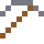
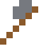
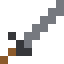

# Hartmetall

Wolframcarbid ist fast so hart wie Diamant: Bohrer, Fräser und die Kugel im Kugelschreiber.

| Eigenschaft | Wert |
|---|---|
|  | Aus Wolframcarbid (Bohrer, Fräser) |
| Dichte | 15,6 g/cm³ |
| Schmilzt bei | 2785 °C |
| Härte | 9 (Mohs) |

## Herstellen

- 1 × [Wolfram](../elemente/wolfram.md) + 1 × [Graphit](../elemente/graphit.md) → 1 × [Hartmetall](../legierungen/hartmetall.md) (Induktionsofen, 8 s)

## Ausrüstung

Aus Hartmetall gibt es Werkzeuge, Waffen und Rüstung (Stufe 4):

-  [Hartmetallspitzhacke](../legierungen/hartmetall.md): 3 × Hartmetall + 2 × Bretter
-  [Hartmetallaxt](../legierungen/hartmetall.md): 3 × Hartmetall + 2 × Bretter
-  [Hartmetallschwert](../legierungen/hartmetall.md): 2 × Hartmetall + 1 × Bretter
-  [Hartmetallhelm](../gegenstaende/hartmetallhelm.md): 5 × Hartmetall
-  [Hartmetallharnisch](../gegenstaende/hartmetallharnisch.md): 8 × Hartmetall
-  [Hartmetallbeinschutz](../gegenstaende/hartmetallbeinschutz.md): 7 × Hartmetall
-  [Hartmetallstiefel](../gegenstaende/hartmetallstiefel.md): 4 × Hartmetall

