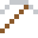
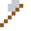
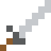

# Hartzinn

Zinnfiguren und Zinnkrüge – Antimon macht das weiche Zinn hart.

| Eigenschaft | Wert |
|---|---|
|  | Aus Zinn mit Antimon |
| Dichte | 7,3 g/cm³ |
| Schmilzt bei | 247 °C |
| Härte | 2 (Mohs) |

## Herstellen

- 9 × [Zinn](../elemente/zinn.md) + 1 × [Antimon](../elemente/antimon.md) → 10 × [Hartzinn](../legierungen/hartzinn.md) (Induktionsofen, 8 s)

## Ausrüstung

Aus Hartzinn gibt es Werkzeuge, Waffen und Rüstung (Stufe 1):

-  Hartzinnspitzhacke: 3 × Hartzinn + 2 × Bretter
-  Hartzinnaxt: 3 × Hartzinn + 2 × Bretter
-  Hartzinnschwert: 2 × Hartzinn + 1 × Bretter
-  Hartzinnhelm: 5 × Hartzinn
-  Hartzinnharnisch: 8 × Hartzinn
-  Hartzinnbeinschutz: 7 × Hartzinn
-  Hartzinnstiefel: 4 × Hartzinn

