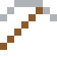

# Inconel

Hält über 1000 °C aus – in Raketentriebwerken und den Auspuffen von Rennwagen.

| Eigenschaft | Wert |
|---|---|
|  | Aus Nickel, Chrom und Eisen (Turbinen) |
| Dichte | 8,44 g/cm³ |
| Schmilzt bei | 1337 °C |
| Härte | 5 (Mohs) |

## Herstellen

- 4 × [Nichrom](../legierungen/nichrom.md) + 1 × [Eisenbarren](../elemente/eisenbarren.md) → 5 × [Inconel](../legierungen/inconel.md) (Induktionsofen, 8 s)

## Ausrüstung

Aus Inconel gibt es Werkzeuge, Waffen und Rüstung (Stufe 2):

-  [Inconelspitzhacke](../legierungen/inconel.md): 3 × Inconel + 2 × Bretter
-  [Inconelaxt](../legierungen/inconel.md): 3 × Inconel + 2 × Bretter
-  [Inconelschwert](../legierungen/inconel.md): 2 × Inconel + 1 × Bretter
-  [Inconelhelm](../gegenstaende/inconelhelm.md): 5 × Inconel
-  [Inconelharnisch](../gegenstaende/inconelharnisch.md): 8 × Inconel
-  [Inconelbeinschutz](../gegenstaende/inconelbeinschutz.md): 7 × Inconel
-  [Inconelstiefel](../gegenstaende/inconelstiefel.md): 4 × Inconel

