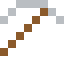
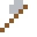

# Invar

Dehnt sich bei Wärme fast gar nicht aus – dafür gab es 1920 den Nobelpreis. Präzisionsuhren und Messgeräte.

| Eigenschaft | Wert |
|---|---|
|  | Aus Eisen und Nickel (dehnt sich kaum aus) |
| Dichte | 8,05 g/cm³ |
| Schmilzt bei | 1427 °C |
| Härte | 4 (Mohs) |

## Herstellen

- 2 × [Eisenbarren](../elemente/eisenbarren.md) + 1 × [Nickel](../elemente/nickel.md) → 3 × [Invar](../legierungen/invar.md) (Induktionsofen, 8 s)

## Ausrüstung

Aus Invar gibt es Werkzeuge, Waffen und Rüstung (Stufe 2):

-  [Invarspitzhacke](../legierungen/invar.md): 3 × Invar + 2 × Bretter
-  [Invaraxt](../legierungen/invar.md): 3 × Invar + 2 × Bretter
-  [Invarschwert](../legierungen/invar.md): 2 × Invar + 1 × Bretter
-  [Invarhelm](../gegenstaende/invarhelm.md): 5 × Invar
-  [Invarharnisch](../gegenstaende/invarharnisch.md): 8 × Invar
-  [Invarbeinschutz](../gegenstaende/invarbeinschutz.md): 7 × Invar
-  [Invarstiefel](../gegenstaende/invarstiefel.md): 4 × Invar

