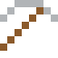
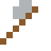

# Kanthal

Glüht dauerhaft bei 1400 °C – Heizdraht in Brennöfen.

| Eigenschaft | Wert |
|---|---|
|  | Aus Eisen, Chrom, Aluminium (Heizdraht) |
| Dichte | 7,1 g/cm³ |
| Schmilzt bei | 1497 °C |
| Härte | 5 (Mohs) |

## Herstellen

- 3 × [Eisenbarren](../elemente/eisenbarren.md) + 1 × [Chrom](../elemente/chrom.md) → 4 × [Kanthal](../legierungen/kanthal.md) (Induktionsofen, 8 s)

## Ausrüstung

Aus Kanthal gibt es Werkzeuge, Waffen und Rüstung (Stufe 2):

-  [Kanthalspitzhacke](../legierungen/kanthal.md): 3 × Kanthal + 2 × Bretter
-  [Kanthalaxt](../legierungen/kanthal.md): 3 × Kanthal + 2 × Bretter
-  [Kanthalschwert](../legierungen/kanthal.md): 2 × Kanthal + 1 × Bretter
-  [Kanthalhelm](../gegenstaende/kanthalhelm.md): 5 × Kanthal
-  [Kanthalharnisch](../gegenstaende/kanthalharnisch.md): 8 × Kanthal
-  [Kanthalbeinschutz](../gegenstaende/kanthalbeinschutz.md): 7 × Kanthal
-  [Kanthalstiefel](../gegenstaende/kanthalstiefel.md): 4 × Kanthal

