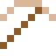

# Konstantan

Sein elektrischer Widerstand ändert sich kaum mit der Temperatur – ideal zum Messen.

| Eigenschaft | Wert |
|---|---|
|  | Aus Kupfer und Nickel |
| Dichte | 8,9 g/cm³ |
| Schmilzt bei | 1227 °C |
| Härte | 3,5 (Mohs) |

## Herstellen

- 1 × [Kupferbarren](../elemente/kupferbarren.md) + 1 × [Nickel](../elemente/nickel.md) → 2 × [Konstantan](../legierungen/konstantan.md) (Induktionsofen, 8 s)

## Ausrüstung

Aus Konstantan gibt es Werkzeuge, Waffen und Rüstung (Stufe 2):

-  [Konstantanspitzhacke](../legierungen/konstantan.md): 3 × Konstantan + 2 × Bretter
-  [Konstantanaxt](../legierungen/konstantan.md): 3 × Konstantan + 2 × Bretter
-  [Konstantanschwert](../legierungen/konstantan.md): 2 × Konstantan + 1 × Bretter
-  [Konstantanhelm](../gegenstaende/konstantanhelm.md): 5 × Konstantan
-  [Konstantanharnisch](../gegenstaende/konstantanharnisch.md): 8 × Konstantan
-  [Konstantanbeinschutz](../gegenstaende/konstantanbeinschutz.md): 7 × Konstantan
-  [Konstantanstiefel](../gegenstaende/konstantanstiefel.md): 4 × Konstantan

