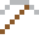
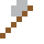
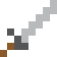

# Lötzinn

Hält jede Platine zusammen. Früher mit Blei, heute mit Silber.

| Eigenschaft | Wert |
|---|---|
|  | Aus Zinn mit Silber |
| Dichte | 7,4 g/cm³ |
| Schmilzt bei | 217 °C |
| Härte | 1,5 (Mohs) |

## Herstellen

- 9 × [Zinn](../elemente/zinn.md) + 1 × [Silber](../elemente/silber.md) → 10 × [Lötzinn](../legierungen/loetzinn.md) (Induktionsofen, 8 s)

## Ausrüstung

Aus Lötzinn gibt es Werkzeuge, Waffen und Rüstung (Stufe 1):

-  Lötzinnspitzhacke: 3 × Lötzinn + 2 × Bretter
-  Lötzinnaxt: 3 × Lötzinn + 2 × Bretter
-  Lötzinnschwert: 2 × Lötzinn + 1 × Bretter
-  Lötzinnhelm: 5 × Lötzinn
-  Lötzinnharnisch: 8 × Lötzinn
-  Lötzinnbeinschutz: 7 × Lötzinn
-  Lötzinnstiefel: 4 × Lötzinn

