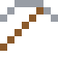
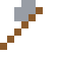

# Maraging-Stahl

Einer der festesten Stähle der Welt: Raketenhüllen, Golfschläger, Uranzentrifugen.

| Eigenschaft | Wert |
|---|---|
|  | Aus Stahl mit viel Nickel |
| Dichte | 8,1 g/cm³ |
| Schmilzt bei | 1427 °C |
| Härte | 6,5 (Mohs) |

## Herstellen

- 4 × [Stahl](../legierungen/stahl.md) + 1 × [Nickel](../elemente/nickel.md) → 5 × [Maraging-Stahl](../legierungen/maraging_stahl.md) (Induktionsofen, 8 s)

## Ausrüstung

Aus Maraging-Stahl gibt es Werkzeuge, Waffen und Rüstung (Stufe 3):

-  [Maraging-Stahlspitzhacke](../legierungen/maraging_stahl.md): 3 × Maraging-Stahl + 2 × Bretter
-  [Maraging-Stahlaxt](../legierungen/maraging_stahl.md): 3 × Maraging-Stahl + 2 × Bretter
-  [Maraging-Stahlschwert](../legierungen/maraging_stahl.md): 2 × Maraging-Stahl + 1 × Bretter
-  [Maraging-Stahlhelm](../gegenstaende/maraging_stahlhelm.md): 5 × Maraging-Stahl
-  [Maraging-Stahlharnisch](../gegenstaende/maraging_stahlharnisch.md): 8 × Maraging-Stahl
-  [Maraging-Stahlbeinschutz](../gegenstaende/maraging_stahlbeinschutz.md): 7 × Maraging-Stahl
-  [Maraging-Stahlstiefel](../gegenstaende/maraging_stahlstiefel.md): 4 × Maraging-Stahl

