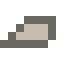
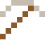
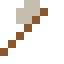
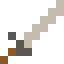

# Monel

Rostet nicht einmal im Meerwasser – Schiffsteile und Brillengestelle.

| Eigenschaft | Wert |
|---|---|
|  | Aus Nickel und Kupfer |
| Dichte | 8,8 g/cm³ |
| Schmilzt bei | 1327 °C |
| Härte | 4 (Mohs) |

## Herstellen

- 2 × [Nickel](../elemente/nickel.md) + 1 × [Kupferbarren](../elemente/kupferbarren.md) → 3 × [Monel](../legierungen/monel.md) (Induktionsofen, 8 s)

## Ausrüstung

Aus Monel gibt es Werkzeuge, Waffen und Rüstung (Stufe 2):

-  Monelspitzhacke: 3 × Monel + 2 × Bretter
-  Monelaxt: 3 × Monel + 2 × Bretter
-  Monelschwert: 2 × Monel + 1 × Bretter
-  Monelhelm: 5 × Monel
-  Monelharnisch: 8 × Monel
-  Monelbeinschutz: 7 × Monel
-  Monelstiefel: 4 × Monel

