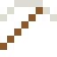

# Neusilber

Heißt Silber und enthält kein bisschen davon – Besteck und Reißverschlüsse.

| Eigenschaft | Wert |
|---|---|
|  | Aus Kupfer, Nickel und Zink |
| Dichte | 8,7 g/cm³ |
| Schmilzt bei | 1097 °C |
| Härte | 3,5 (Mohs) |

## Herstellen

- 3 × [Messing](../legierungen/messing.md) + 1 × [Nickel](../elemente/nickel.md) → 4 × [Neusilber](../legierungen/neusilber.md) (Induktionsofen, 8 s)

## Ausrüstung

Aus Neusilber gibt es Werkzeuge, Waffen und Rüstung (Stufe 2):

-  Neusilberspitzhacke: 3 × Neusilber + 2 × Bretter
-  Neusilberaxt: 3 × Neusilber + 2 × Bretter
-  Neusilberschwert: 2 × Neusilber + 1 × Bretter
-  Neusilberhelm: 5 × Neusilber
-  Neusilberharnisch: 8 × Neusilber
-  Neusilberbeinschutz: 7 × Neusilber
-  Neusilberstiefel: 4 × Neusilber

