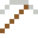
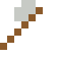
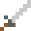

# Nichrom

Glüht rot, ohne durchzubrennen – in jedem Toaster und Föhn.

| Eigenschaft | Wert |
|---|---|
|  | Aus Nickel und Chrom (Heizdraht) |
| Dichte | 8,4 g/cm³ |
| Schmilzt bei | 1400 °C |
| Härte | 4,5 (Mohs) |

## Herstellen

- 4 × [Nickel](../elemente/nickel.md) + 1 × [Chrom](../elemente/chrom.md) → 5 × [Nichrom](../legierungen/nichrom.md) (Induktionsofen, 8 s)

## Ausrüstung

Aus Nichrom gibt es Werkzeuge, Waffen und Rüstung (Stufe 2):

-  Nichromspitzhacke: 3 × Nichrom + 2 × Bretter
-  Nichromaxt: 3 × Nichrom + 2 × Bretter
-  Nichromschwert: 2 × Nichrom + 1 × Bretter
-  Nichromhelm: 5 × Nichrom
-  Nichromharnisch: 8 × Nichrom
-  Nichrombeinschutz: 7 × Nichrom
-  Nichromstiefel: 4 × Nichrom

## Verwendet für

[Edelstahl](../legierungen/edelstahl.md), [Inconel](../legierungen/inconel.md)

