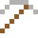

# Nitinol

Hat ein Gedächtnis: Verbogen springt es beim Erwärmen in seine alte Form zurück. Stents in Blutgefäßen.

| Eigenschaft | Wert |
|---|---|
|  | Aus Nickel und Titan (Formgedächtnis) |
| Dichte | 6,45 g/cm³ |
| Schmilzt bei | 1310 °C |
| Härte | 5 (Mohs) |

## Herstellen

- 1 × [Nickel](../elemente/nickel.md) + 1 × [Titanbarren](../elemente/titanbarren.md) → 2 × [Nitinol](../legierungen/nitinol.md) (Induktionsofen, 8 s)

## Ausrüstung

Aus Nitinol gibt es Werkzeuge, Waffen und Rüstung (Stufe 2):

-  Nitinolspitzhacke: 3 × Nitinol + 2 × Bretter
-  Nitinolaxt: 3 × Nitinol + 2 × Bretter
-  Nitinolschwert: 2 × Nitinol + 1 × Bretter
-  Nitinolhelm: 5 × Nitinol
-  Nitinolharnisch: 8 × Nitinol
-  Nitinolbeinschutz: 7 × Nitinol
-  Nitinolstiefel: 4 × Nitinol

