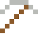

# Permalloy

Lässt sich so leicht magnetisieren, dass es Magnetfelder abschirmt – um frühe Tiefseekabel gewickelt.

| Eigenschaft | Wert |
|---|---|
|  | Aus Nickel und Eisen (magnetisch weich) |
| Dichte | 8,7 g/cm³ |
| Schmilzt bei | 1447 °C |
| Härte | 4 (Mohs) |

## Herstellen

- 4 × [Nickel](../elemente/nickel.md) + 1 × [Eisenbarren](../elemente/eisenbarren.md) → 5 × [Permalloy](../legierungen/permalloy.md) (Induktionsofen, 8 s)

## Ausrüstung

Aus Permalloy gibt es Werkzeuge, Waffen und Rüstung (Stufe 2):

-  [Permalloyspitzhacke](../legierungen/permalloy.md): 3 × Permalloy + 2 × Bretter
-  [Permalloyaxt](../legierungen/permalloy.md): 3 × Permalloy + 2 × Bretter
-  [Permalloyschwert](../legierungen/permalloy.md): 2 × Permalloy + 1 × Bretter
-  [Permalloyhelm](../gegenstaende/permalloyhelm.md): 5 × Permalloy
-  [Permalloyharnisch](../gegenstaende/permalloyharnisch.md): 8 × Permalloy
-  [Permalloybeinschutz](../gegenstaende/permalloybeinschutz.md): 7 × Permalloy
-  [Permalloystiefel](../gegenstaende/permalloystiefel.md): 4 × Permalloy

