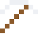

# Platin-Iridium

Daraus war bis 2019 das Urkilogramm in Paris – das Maß aller Kilogramm.

| Eigenschaft | Wert |
|---|---|
|  | Aus Platin mit Iridium |
| Dichte | 21,5 g/cm³ |
| Schmilzt bei | 1827 °C |
| Härte | 5 (Mohs) |

## Herstellen

- 9 × [Platin](../elemente/platin.md) + 1 × [Iridium](../elemente/iridium.md) → 10 × [Platin-Iridium](../legierungen/platin_iridium.md) (Induktionsofen, 8 s)

## Ausrüstung

Aus Platin-Iridium gibt es Werkzeuge, Waffen und Rüstung (Stufe 2):

-  Platin-Iridiumspitzhacke: 3 × Platin-Iridium + 2 × Bretter
-  Platin-Iridiumaxt: 3 × Platin-Iridium + 2 × Bretter
-  Platin-Iridiumschwert: 2 × Platin-Iridium + 1 × Bretter
-  Platin-Iridiumhelm: 5 × Platin-Iridium
-  Platin-Iridiumharnisch: 8 × Platin-Iridium
-  Platin-Iridiumbeinschutz: 7 × Platin-Iridium
-  Platin-Iridiumstiefel: 4 × Platin-Iridium

