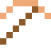
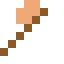

# Rotgold

Je mehr Kupfer, desto rötlicher. In Russland war Gold oft rot.

| Eigenschaft | Wert |
|---|---|
|  | Aus Gold mit Kupfer |
| Dichte | 15 g/cm³ |
| Schmilzt bei | 927 °C |
| Härte | 3 (Mohs) |

## Herstellen

- 3 × [Goldbarren](../elemente/goldbarren.md) + 1 × [Kupferbarren](../elemente/kupferbarren.md) → 4 × [Rotgold](../legierungen/rotgold.md) (Induktionsofen, 8 s)

## Ausrüstung

Aus Rotgold gibt es Werkzeuge, Waffen und Rüstung (Stufe 1):

-  Rotgoldspitzhacke: 3 × Rotgold + 2 × Bretter
-  Rotgoldaxt: 3 × Rotgold + 2 × Bretter
-  Rotgoldschwert: 2 × Rotgold + 1 × Bretter
-  Rotgoldhelm: 5 × Rotgold
-  Rotgoldharnisch: 8 × Rotgold
-  Rotgoldbeinschutz: 7 × Rotgold
-  Rotgoldstiefel: 4 × Rotgold

