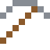
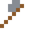

# Schwermetall

Fast so dicht wie Gold, aber hart: Gegengewichte in Flugzeugen und Rennwagen.

| Eigenschaft | Wert |
|---|---|
|  | Aus Wolfram mit Nickel (sehr schwer) |
| Dichte | 17,5 g/cm³ |
| Schmilzt bei | 1477 °C |
| Härte | 6,5 (Mohs) |

## Herstellen

- 9 × [Wolfram](../elemente/wolfram.md) + 1 × [Nickel](../elemente/nickel.md) → 10 × [Schwermetall](../legierungen/schwermetall.md) (Induktionsofen, 8 s)

## Ausrüstung

Aus Schwermetall gibt es Werkzeuge, Waffen und Rüstung (Stufe 3):

-  Schwermetallspitzhacke: 3 × Schwermetall + 2 × Bretter
-  Schwermetallaxt: 3 × Schwermetall + 2 × Bretter
-  Schwermetallschwert: 2 × Schwermetall + 1 × Bretter
-  Schwermetallhelm: 5 × Schwermetall
-  Schwermetallharnisch: 8 × Schwermetall
-  Schwermetallbeinschutz: 7 × Schwermetall
-  Schwermetallstiefel: 4 × Schwermetall

